# Results

Everything measured, in the order it was settled. Arm names on fscratch keep
the old tier prefixes, given per section so the docs and the filesystem agree.

Contents: [batch size](#global-batch-size) ·
[optimizer](#optimizer) · [MLM objective](#the-mlm-objective) ·
[LR re-check](#the-lr-re-check-at-20-masking) ·
[downstream](#downstream-across-67-arms) · [FA3 fork](#flashattention-3-fork-ab)

Per-arm downstream scores for all 67 arms are in
[eval-table.md](eval-table.md).

---

## Global batch size

Arms `t0b-*`. 26 runs, token-matched at 10.07B tokens each, h1024/L32 399.6M, 4 nodes. Not
wall-clock matched: the point was to isolate the batch effect. Settled before
the optimizer, because both optimizers' LR optima move with batch size.

First round, one LR rule per cell:

| optimizer | batch | grad_accum | LR | rule | eval @ 10.07B |
|---|---|---|---|---|---|
| AdamW | 1.05M | 1 | 1e-4 | anchor | 2.3819 |
| AdamW | 2.10M | 2 | 1.41e-4 | sqrt(B) | 2.3822 |
| AdamW | 2.10M | 2 | 2e-4 | linear | **2.3716** |
| AdamW | 4.19M | 4 | 2e-4 | sqrt(B) | 2.3980 |
| AdamW | 4.19M | 4 | 4e-4 | linear | 2.3828 |
| NorMuon | 1.05M | 1 | 1e-2 | anchor | 2.3367 |
| NorMuon | 2.10M | 2 | 1.41e-2 | sqrt(B) | 2.3516 |
| NorMuon | 2.10M | 2 | 2e-2 | linear | 2.4582 |
| NorMuon | 4.19M | 4 | 2e-2 | sqrt(B) | 2.3882 |
| NorMuon | 4.19M | 4 | 4e-2 | linear | 2.5116 |

**Why that round decided nothing.** For NorMuon the winning LR was, at every
batch, the lowest one tested. Both scaling rules raise LR with batch, so
"bigger batch is worse" and "lower LR is better" were entangled. Filling in
lower LRs reversed the reading twice: round 1 made big batches look bad, round 2
made 1M look best purely because 1M was the only batch given a 7e-3 point.
Nothing about the batch axis is conclusive until every batch has an interior
minimum, meaning a point where going lower makes the loss worse.

Rounds 3 and 4 got there. NorMuon, eval loss at 10.07B tokens (two sessions of
the same fork submitted overlapping grids 34 s apart, so three cells are
duplicate pairs; those are kept, since same-config repeats measure
sigma_repeat):

| LR | 1M | 2M | 4M |
|---|---|---|---|
| 2.5e-3 | 2.3169 | - | 2.3474 |
| 3.5e-3 | 2.3100 / 2.3106 | - | 2.3337 |
| 5e-3 | **2.3086 / 2.3089** | **2.3118** | 2.3248 / 2.3250 |
| 7e-3 | 2.3114 | **2.3118** | **2.3200** |
| 1e-2 | 2.3367 | 2.3209 | 2.3212 |
| 1.41e-2 | - | 2.3516 | 2.3369 |
| 2e-2 | - | 2.4582 | 2.3882 |

1M and 4M are bracketed on both sides. 2M has 5e-3 and 7e-3 tied with 1e-2
worse, and its low side is untested, but both neighbours turn up below 5e-3.

**Best per batch: 1M 2.3086, 2M 2.3118, 4M 2.3200.** Monotone, and the 1M-to-4M
gap of 0.0114 is ~29x sigma_repeat, so it is signal. Against AdamW's best
anywhere of 2.3716, NorMuon's worst bracketed point still wins; the optimizer
gap is 0.05 to 0.06 at every batch. The first round said otherwise, with the
margin shrinking from -0.045 at 1M to -0.020 at 2M and reversing to +0.005 at
4M; that was purely an LR artifact of running NorMuon above its optimum at the
larger batches.

Three things about LR came out of the same grid and set up Tier 1:

- **The optimum barely moves with batch**: 5e-3 at 1M and 2M, 7e-3 at 4M. A
  factor 1.4 across a 4x batch change, roughly B^0.24. Neither sqrt(B) nor
  linear describes it, and both overshot at 4M (2e-2 cost 0.068 against 7e-3,
  4e-2 cost 0.19). So Tier 1's grids are anchored on measured optima, not a
  rule.
- **NorMuon's curve is asymmetric**: flat below the optimum (0.003 across
  3.5e-3 to 7e-3 at 1M), punishing above (1e-2 costs 0.028, 2e-2 costs 0.15).
  A grid should sit at or below the optimum, not straddle it from above.
- **NorMuon is far more LR-sensitive than AdamW.** At 2M, 1.41e-2 to 2e-2 costs
  0.107, while AdamW's entire spread over every batch and LR is 0.026. AdamW is
  nearly flat: best-per-batch spread 0.011, and 1M vs 4M differ by 0.0009, so
  4.19M would be free for AdamW.

### At the real horizon: the ranking reverses (2026-09-25)

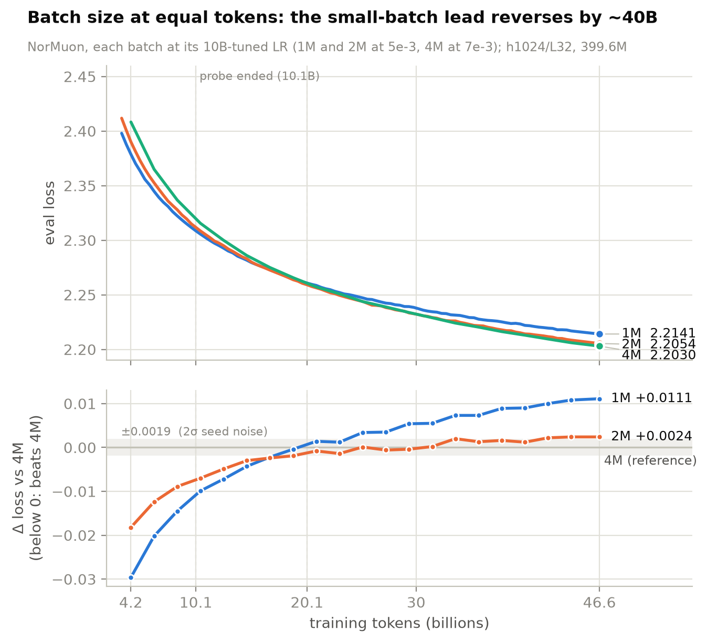

The probe above was read at 10.07B tokens, a quarter of a real arm. Each batch's
best NorMuon arm was then continued to 44.04B tokens, the token count of the
4M control's step 10500, reading the 4M point from `t1a-normuon-lr7e-3`, which
has the identical training config (it and the 4M probe arm agree where they
overlap). Resumes carried the exact data position (reconstructed for the
pre-fix probe checkpoints, recorded natively after), and every read is an eval
at exactly that token count:

| tokens | 1M (5e-3) | 2M (5e-3) | 4M (7e-3) |
|---|---|---|---|
| 10.07B | **2.3086** | 2.3118 | 2.3200 |
| 20.13B | 2.2608 | **2.2592** | 2.2615 |
| 39.85B | 2.2220 | 2.2142 | **2.2130** |
| 44.04B | 2.2169 | 2.2085 | **2.2061** |
| 46.59B | 2.2141 | 2.2054 | **2.2030** |

The 46.59B row is the 4M control's own checkpoint (step 11107) with 1M and 2M resumed to exactly its token count (steps 44428 / 22214); all three are scored by the pipeline's eval-only mode at that step (below). **4M is best at the horizon that matters**: 1M is +0.0108 (5.7x the 0.0019
threshold), 2M +0.0024 (1.3x, marginal). The 10B ordering was a short-horizon
effect: small batches get more optimizer steps early, and that advantage is
gone by ~20B and reversed by ~40B. Caveat: 1M and 2M keep the LR picked at 10B;
a lower LR might suit their longer horizon better, so the 1M deficit is an
upper bound in the same sense the original 0.0114 was.

Downstream at 20.13B (dev mode) mildly favours 1M on contacts (supervised long
P@L 0.342 / 0.332 / 0.330 for 1M / 2M / 4M), inside what one seed can resolve;
the 44B eval is job 2005881.

Downstream at equal tokens (dev mode, synced eval tree), all three at exactly
46,586,134,528 tokens: the 4M control's checkpoint-11107, with 1M and 2M
resumed to the same token count (steps 44428 / 22214):

| batch | PGYM | zero-shot long P@L | supervised long P@L | newPISCES364 | scl |
|---|---|---|---|---|---|
| 1M | 0.3382 | **0.4050** | **0.3966** | 0.7897 | 0.5426 |
| 2M | 0.3402 | 0.3927 | 0.3894 | **0.7901** | **0.5530** |
| 4M | **0.3492** | 0.4008 | 0.3957 | 0.7897 | 0.5468 |

PGYM favours 4M by 0.0110 over 1M (1.4x its measured 0.0081 floor); zero-shot contact
favours 1M by 0.0042 (0.5x, noise); supervised contact is
a 1M/4M tie with 2M lowest; newPISCES364 is flat. scl scatters with no batch
trend. With loss favouring 4M by 5.8x its floor, nothing downstream argues
against 4M. Under the equal-step floors measured since (PGYM 0.0081, zero-shot 0.0081, supervised 0.0141, newPISCES364 0.0027, scl 0.0269; figure bands) PGYM is the only readout that separates the batches: 4M leads 1M by 0.0110 (1.4x) and 2M by 0.0090 (1.1x), both just past the floor. Every other downstream gap sits inside its band, so loss (4M by 5.8x) remains the decider.

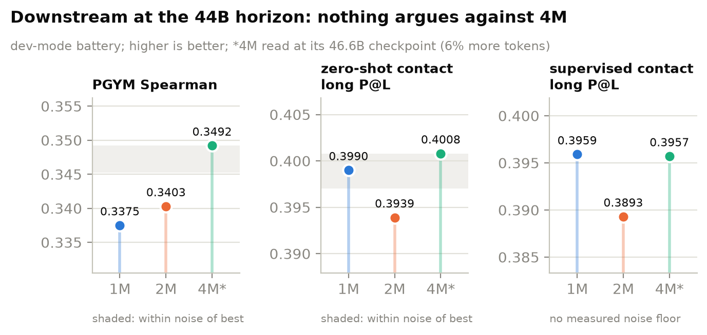

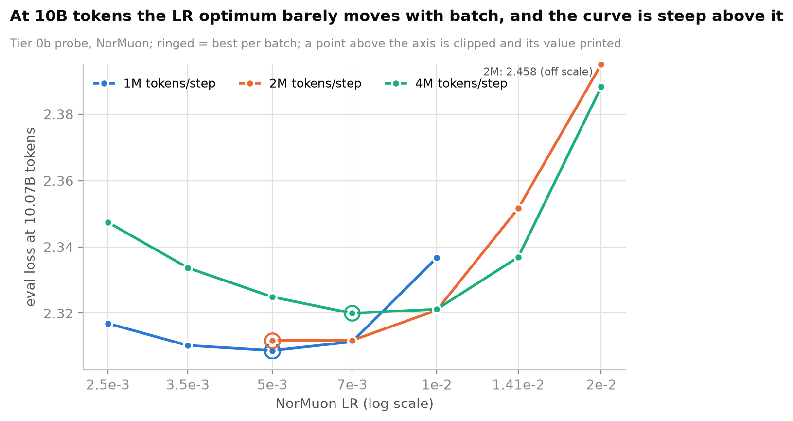

Figures from `design/batch-44b/plots.py` on fscratch.

**Chose 4.19M**, at a cost of 0.0114. **Confirmed at 44B, where 4M is best outright (above).** Reasoning in
[decisions.md](decisions.md#global-batch-size-419m-tokens).

---

## Optimizer

Arms `t1a-*` (learning rate) and `t1b-*` (knobs). Base: h1024/L32 399.6M, 4.19M tokens/step (ga 4), 6 h stable on 4 nodes,
~10,500-11,750 steps, ~44-49B tokens. NorMuon at dion's defaults with
spectral_norm scaling, weight decay matched at 1e-5 on both optimizers.

Two loss columns throughout, because node placement moved step time
1826-1998 ms across runs differing **only** in LR, so the wall-clock stop hands
different token budgets to identical configurations. Same-compute arms are read
in the equal-step column.

### Learning rate (10 runs)

| AdamW | steps | wall-clock | equal-step (10500) |
|---|---|---|---|
| **5.6e-4** | 10500 | **2.2350** | **2.2350** |
| 8e-4 | 10500 | 2.2365 | 2.2365 |
| 4e-4 | 11000 | 2.2374 | 2.2413 |
| 2.8e-4 | 10500 | 2.2489 | 2.2489 |
| 2e-4 | 11000 | 2.2566 | 2.2607 |

| NorMuon | steps | wall-clock | equal-step (10500) |
|---|---|---|---|
| **7e-3** | 11000 | 2.2038 | **2.2061** |
| 5e-3 | 11500 | **2.2011** | 2.2068 |
| 3.5e-3 | 10500 | 2.2111 | 2.2111 |
| 1e-2 | 10500 | 2.2116 | 2.2116 |
| 1.41e-2 | 10500 | 2.2623 | 2.2623 |

**NorMuon beats AdamW by 0.0289** (2.2061 vs 2.2350), each at its own tuned LR.
That is 15x the 2-sigma threshold and the largest effect the series has
produced.

Both optima are interior, so neither grid needs extending. AdamW's 5.6e-4 sits
beside ESM C's published 5e-4 for their 300M at the same 4.2M batch, which is a
useful independent check that our setup is not somewhere strange. NorMuon's
7e-3 reproduces the Tier 0b measurement made at a quarter of the tokens; 5e-3
is 0.0007 behind at equal steps, effectively tied, and 7e-3 is taken because two
independent measurements agree on it.

**Node placement reordered this grid.** On wall clock 5e-3 looked best, having
drawn nodes 8% faster and run 500 extra steps, worth about 0.004 at the late-run
slope. At equal steps 7e-3 wins. The AdamW ordering was unaffected.

### The LR grid at step 13000 (2026-09-25)

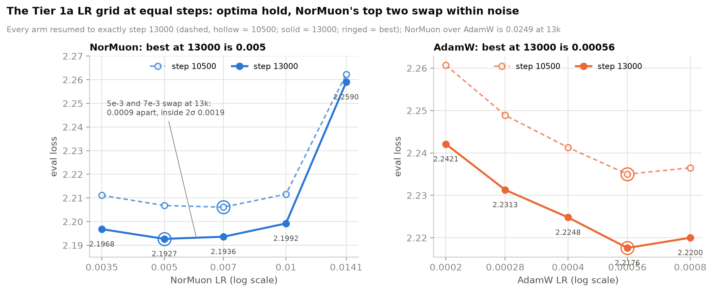

The LR arms had the same step-count flaw as the knob arms, so all ten were
resumed to exactly step 13000 (the two winners as the Tier 1b controls, the
other eight in jobs 2016917-27; exact data position in every resume).

| NorMuon LR | @10500 | **@13000** | | AdamW LR | @10500 | **@13000** |
|---|---|---|---|---|---|---|
| 3.5e-3 | 2.2111 | 2.1968 | | 2e-4 | 2.2607 | 2.2421 |
| **5e-3** | 2.2068 | **2.1927** | | 2.8e-4 | 2.2489 | 2.2313 |
| 7e-3 | **2.2061** | 2.1936 | | 4e-4 | 2.2413 | 2.2248 |
| 1e-2 | 2.2116 | 2.1992 | | **5.6e-4** | **2.2350** | **2.2176** |
| 1.41e-2 | 2.2623 | 2.2590 | | 8e-4 | 2.2365 | 2.2200 |

NorMuon's top two swap: 5e-3 now leads 7e-3 by 0.0009, inside the ~0.0020
two-sigma floor, so still a tie, but it is the direction the LR-horizon
argument predicts (the constant-LR optimum drifts lower with more steps). It
is the first sign of that drift in our own data and a reason the final run
re-checks a lower LR. AdamW keeps 5.6e-4. NorMuon over AdamW: 0.0249 at 13k.
Downstream at 13000 (dev mode; controls from the Tier 1b step-matched set):

| NorMuon LR | PGYM | zero-shot | supervised | newPISCES364 | scl |
|---|---|---|---|---|---|
| 3.5e-3 | 0.3451 | 0.3861 | 0.3908 | 0.7926 | 0.5634 |
| 5e-3 | 0.3475 | 0.4014 | 0.3982 | 0.7894 | 0.5468 |
| 7e-3 | 0.3458 | 0.4110 | 0.4011 | 0.7943 | 0.5405 |
| 1e-2 | 0.3444 | 0.4087 | 0.4125 | 0.7916 | 0.5593 |
| **1.41e-2** | **0.2944** | **0.0095** | **0.0400** | **0.5095** | **0.2370** |

| AdamW LR | PGYM | zero-shot | supervised | newPISCES364 | scl |
|---|---|---|---|---|---|
| 2e-4 | 0.3330 | 0.2978 | 0.3218 | 0.7816 | 0.5509 |
| 2.8e-4 | 0.3335 | 0.3068 | 0.3428 | 0.7816 | 0.5343 |
| 4e-4 | 0.3320 | 0.3450 | 0.3630 | 0.7842 | 0.5343 |
| 5.6e-4 | 0.3369 | 0.3324 | 0.3569 | 0.7855 | 0.5489 |
| 8e-4 | 0.3394 | 0.3392 | 0.3483 | 0.7857 | 0.5717 |

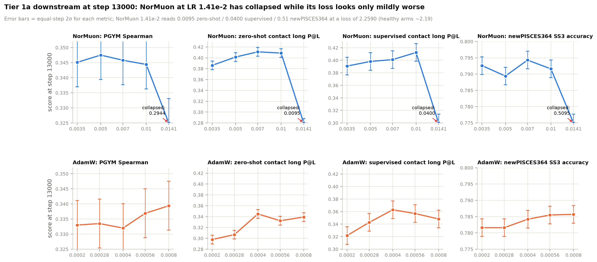

Within NorMuon 3.5e-3 to 1e-2 every downstream readout is flat inside its
floor, so downstream agrees with the loss that the optimum is broad. NorMuon
beats AdamW by 0.04-0.07 on both contact readouts at every LR pairing.

**NorMuon 1.41e-2 has collapsed downstream, and loss barely shows it.** Its
eval loss is 2.2590, +0.065 over the healthy arms and even slightly *better*
than at 10500 (2.2623), yet zero-shot contact fell from 0.2757 at its 10.8k
wall-clock checkpoint to 0.0095 at 13000, supervised contact reads 0.0400,
newPISCES364 0.5095 (healthy ~0.79) and scl 0.2370. The representation keeps
degrading while the MLM loss holds. This is the second arm with loss and
structure decoupled (after `t0b-normuon-b1M-1721969`, below), both NorMuon
above its optimum; together they say an LR a notch too high can destroy the
features downstream tasks read without the loss curve raising an alarm.
Practical rule: never adopt an LR or architecture on loss alone near the top
of a stable range, and watch a cheap structural readout (newPISCES364, the
sharpest downstream metric) during long runs.

### Weight decay, beta2, and the nanoplm deviations (10 runs)

At the winning LRs. Controls are the LR winners, so nothing was re-run.

**NorMuon**, control `t1a-normuon-lr7e-3`: wall-clock 2.2038 (11000 steps),
equal-step 2.2095.

| arm | steps | wall-clock | equal-step | delta (equal) |
|---|---|---|---|---|
| **wd 1e-5** | 10500 | **2.2014** | **2.2045** | **-0.0050** |
| cautious=true | 10000 | 2.2077 | 2.2077 | -0.0018 |
| beta2 0.9 | 10500 | 2.2072 | 2.2102 | +0.0007 |
| nesterov=true | 10500 | 2.2068 | 2.2102 | +0.0007 |
| beta2 0.98 | 10500 | 2.2085 | 2.2114 | +0.0019 |
| wd 0.1 | 10500 | 2.2497 | 2.2514 | +0.0419 |

**AdamW**, control `t1a-adamw-lr5.6e-4`: wall-clock 2.2350, equal-step 2.2387.

| arm | steps | wall-clock | equal-step | delta (equal) |
|---|---|---|---|---|
| beta2 0.95 | 10500 | 2.2353 | 2.2390 | +0.0003 |
| wd 0.01 | 11000 | 2.2317 | 2.2398 | +0.0011 |
| wd 0.1 | 10500 | 2.2380 | 2.2421 | +0.0034 |
| beta2 0.999 | 10500 | 2.2440 | 2.2485 | +0.0098 |

Verdicts against the pre-registered threshold of 0.0019 at equal steps:

| candidate | delta | verdict |
|---|---|---|
| NorMuon over AdamW | -0.0289 | **WINS**, 15x |
| NorMuon wd 1e-5 (vs dion's 0.01) | -0.0050 | **WINS**, 2.6x |
| cautious_wd = true | -0.0018 | no measured effect |
| nesterov = true | +0.0007 | no measured effect |
| NorMuon beta2 0.9 / 0.98 | +0.0007 / +0.0019 | no measured effect |
| AdamW beta2 0.95 | +0.0003 | no measured effect |
| AdamW wd 0.01 | +0.0011 | no measured effect |

**Weight decay matters asymmetrically for NorMuon**: 1e-5 gains 0.0050, 0.1
loses 0.0419. An 8x span around dion's 0.01 moves the loss by 0.047, so this is
not a knob to leave at a library default. beta2 is close to flat for NorMuon
(0.9 and 0.98 both within 0.002 of 0.95) and matters for AdamW on the high side
(0.999 costs 0.0098).

**Both nanoplm deviations are ties, and cautious decay is not slower.** An
earlier reading had it ~5% slower and therefore losing on wall clock. Wrong: its
run was the only one on jpbo-013, and the trace says the slowdown is the node.

| | cautious (jpbo-013) | wd1e-5 (jpbo-001) |
|---|---|---|
| GEMM launches | 11,861 | 11,861 |
| GEMM us/launch | 680.5 | 676.6 (ratio 1.006) |
| `multi_tensor_apply` | 75.2 ms | 75.7 ms |
| compute union | 13,286 ms | 13,436 ms |
| exposed NCCL/step | 174.2 ms | 89.8 ms |
| step time | 2091 ms | 1981 ms |

`multi_tensor_apply` holds the optimizer's elementwise work and is identical;
compute union is 1% *lower*. The 110 ms step difference is the 84 ms/step of
extra exposed comms on that node group. So cautious decay is a tie, arguably a
marginal win, and stays off only because -0.0018 does not clear the floor.

**AdamW's stock ModernBERT settings are already the best of those tested** (wd
1e-5, beta2 0.98), which is convenient: the paper's baseline is not handicapped.

**Storage aside.** NorMuon checkpoints are 3.0 GB against AdamW's 4.5 GB,
because its optimizer state is smaller, so choosing NorMuon takes about 30% off
the series storage bill.

### Step-matched to 13000 (2026-09-24)

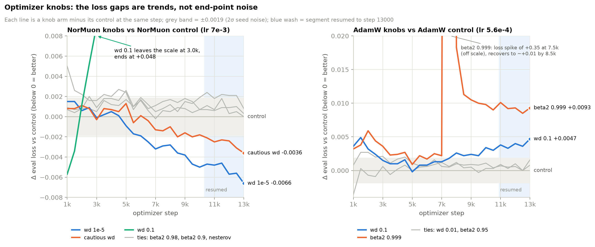

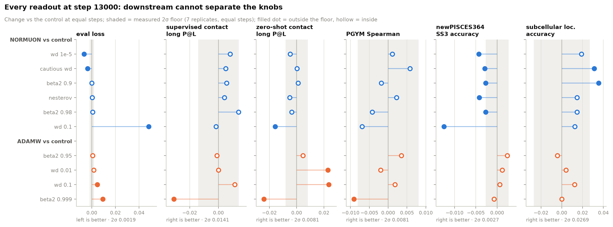

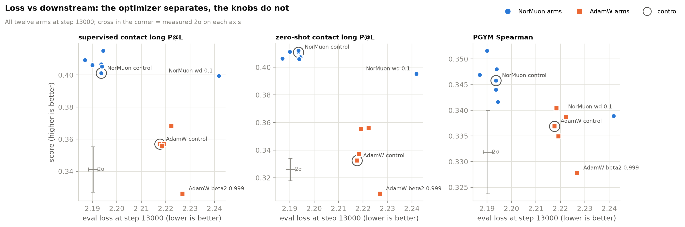

Figures from `design/optim-s13k/plots.py` on fscratch; noise bands are the equal-step floors measured 2026-09-25. One event the curves show that the tables do not: AdamW beta2 0.999 spiked by +0.35 in eval loss at step 7500 and was back to ~+0.01 by 8500, a transient instability that beta2 0.98 and 0.95 never had.

The Tier 1b verdicts above were read on loss at a common step, but their
downstream scores came from whatever step each arm's node allowed (10303 to
11020). All ten knob arms and both LR-winner controls were resumed to exactly
step 13000 and rescored, so every column now sits at one step. Full table in
[eval-table.md](eval-table.md#tier-1a-controls--tier-1b-at-step-13000-step-matched).

| arm | d loss @13000 | (was @10500) | d sup contact | d zero-shot long P@L | d PGYM |
|---|---|---|---|---|---|
| **NorMuon control** (7e-3) | 2.1936 | | 0.4011 | 0.4110 | 0.3458 |
| wd 1e-5 | **-0.0066** | -0.0050 | +0.0082 | -0.0047 | +0.0011 |
| cautious=true | **-0.0036** | -0.0018 | +0.0051 | +0.0003 | +0.0058 |
| beta2 0.9 | 0.0000 | +0.0007 | +0.0056 | +0.0010 | -0.0018 |
| nesterov=true | +0.0003 | +0.0007 | +0.0041 | -0.0051 | +0.0022 |
| beta2 0.98 | +0.0008 | +0.0019 | +0.0140 | -0.0037 | -0.0042 |
| wd 0.1 | +0.0482 | +0.0419 | -0.0017 | -0.0157 | -0.0069 |
| **AdamW control** (5.6e-4) | 2.2176 | | 0.3569 | 0.3324 | 0.3369 |
| beta2 0.95 | +0.0008 | +0.0003 | -0.0010 | +0.0046 | +0.0035 |
| wd 0.01 | +0.0016 | +0.0011 | +0.0000 | +0.0229 | -0.0020 |
| wd 0.1 | +0.0047 | +0.0034 | +0.0113 | +0.0235 | +0.0018 |
| beta2 0.999 | +0.0093 | +0.0098 | -0.0309 | -0.0240 | -0.0091 |

Control rows give absolute values; the rest are deltas against their control.

**On loss, one verdict moves.** Cautious weight decay goes from -0.0018 (under
the 0.0019 threshold) to -0.0036, 1.9x. It points the same way as wd 1e-5 (both
weaken effective decay), so the two may be one effect; the combination has
never been run, and this is one run per arm. wd 1e-5 strengthens (-0.0066).
Everything else keeps its verdict. NorMuon over AdamW is -0.0240 at 13000
against -0.0289 at 10500.

**Downstream does not resolve the knobs.** Supervised contact has no measured
noise floor, and its behaviour here says the floor is wide: every NorMuon knob
arm, including wd 0.1 at +0.048 loss, lands within -0.002 to +0.014 of the
control, so the control itself looks like a low draw. Zero-shot long P@L
(2 sigma 0.0038 dev) and PGYM (0.0040) put every NorMuon knob inside or near
their floors except wd 0.1. Only the large effects clear on every readout:
NorMuon over AdamW (+0.044 supervised, +0.079 zero-shot, +0.009 PGYM) and
AdamW beta2 0.999 as a loser (-0.031 / -0.024 / -0.009).

### Follow-ups, fresh to step 13000 (2026-09-25)

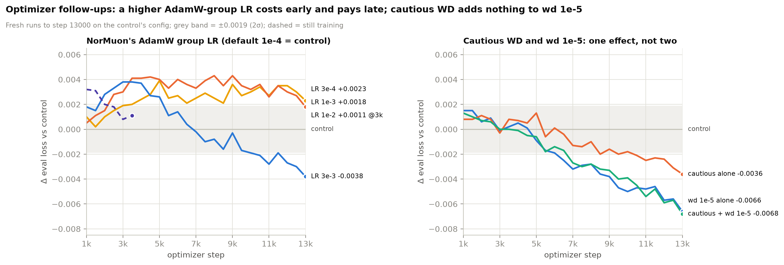

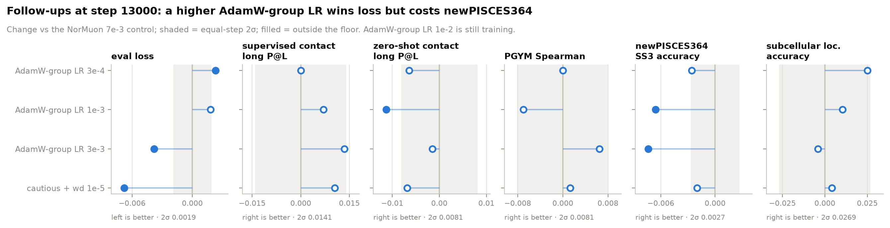

Downstream at 13000 (dev mode), change vs the control (PGYM 0.3458, zero-shot
0.4110, supervised 0.4011, newPISCES364 0.7943, scl 0.5405), against the
equal-step floors:

| arm | PGYM | zero-shot | supervised | newPISCES364 | scl |
|---|---|---|---|---|---|
| AdamW-group LR 3e-4 | 0.0000 | -0.0064 | 0.0000 | -0.0026 | +0.0250 |
| AdamW-group LR 1e-3 | -0.0070 | **-0.0113** | +0.0070 | **-0.0066** | +0.0104 |
| AdamW-group LR 3e-3 | +0.0065 | -0.0015 | +0.0135 | **-0.0074** | -0.0041 |
| AdamW-group LR 1e-2 | +0.0071 | 0.0000 | +0.0039 | +0.0006 | +0.0146 |
| cautious + wd 1e-5 | +0.0013 | -0.0068 | +0.0105 | -0.0020 | +0.0042 |
| 2 sigma | 0.0081 | 0.0081 | 0.0141 | 0.0027 | 0.0269 |

Bold = outside the floor. newPISCES364 drops 0.0066 at 1e-3 and 0.0074 at
3e-3 (2.4-2.7x its floor), and 1e-3 also loses zero-shot contact (1.4x). **But
the 1e-2 arm, which brackets the sweep, has the same loss gain (-0.0034 vs
-0.0038 at 3e-3, a plateau) with no cost anywhere** (newPISCES364 +0.0006,
every column inside its floor). So the newPISCES364 drop is not a monotone
cost of the higher LR; with one seed per arm it reads as a fluctuation at
1e-3/3e-3, not a trade-off. The AdamW-group LR plateau is 3e-3 to 1e-2, with
1e-2 the cleaner candidate; measured on the stock base, so it is re-checked on
the modernized base before it goes into the recipe.

Four arms trained from step 0 to 13000 on the NorMuon 7e-3 control's exact
config, read against that control at the same step (2.1936 at 13000; the
control reached 13000 by resume, which reproduces a continuous run to within
noise).

**The AdamW group's LR.** Under NorMuon, every non-matrix parameter
(embedding, unembedding, all 66 LayerNorm weights, 133k parameters) sits in one
AdamW group at `adam_learning_rate: 1e-4`, which had never been tuned.

| AdamW-group LR | 4k | 7k | 10k | 13k |
|---|---|---|---|---|
| 1e-4 (control) | 0 | 0 | 0 | 0 |
| 3e-4 | +0.0024 | +0.0025 | +0.0030 | +0.0023 |
| 1e-3 | +0.0041 | +0.0033 | +0.0032 | +0.0018 |
| **3e-3** | +0.0037 | -0.0002 | -0.0019 | **-0.0038** |

A higher group LR costs early and pays late: 3e-3 is worse through 5k,
crosses the control at 7k and is still pulling away at 13k, 2x the 0.0019
threshold. 3e-4 and 1e-3 sit at the threshold edge on the wrong side, so the
curve is not clean. 3e-3 is the top of the grid, so by the edge rule a 1e-2 arm
runs before anything is adopted (job 2015098). Also a warning about short
reads: at 4k every raised LR looked like a loss.

**Cautious WD with wd 1e-5: one effect, not two.** Combined, -0.0068 at 13k,
against -0.0066 for wd 1e-5 alone and -0.0036 for cautious alone. Cautious
decay's gain was the same weaker-decay effect; on top of wd 1e-5 it adds
nothing. The base keeps wd 1e-5 with cautious off.

---

## The MLM objective

Arms `t1c-*`. 15 runs. Ordered before the architecture tiers deliberately: masking rate
changes the task, and a task change moves what the architecture should be.

A 5 x 3 factorial rather than one-at-a-time, because rate and corruption split
plausibly interact: at 15% masking, a 10% random share is a larger fraction of a
smaller signal. All arms at base LR 7e-3, NorMuon, 4.19M tokens/step, 6 h on
4 nodes. Eval masking pinned at 15% / 80-10-10 / seed 20260908 for every arm,
verified in the generated configs. Loss at step 10000, the largest step all 15
reached:

| rate | 80/10/10 | 90/5/5 | 100/0/0 |
|---|---|---|---|
| 15% | 2.2050 | 2.2040 | 2.3523 |
| **20%** | **2.1975** | **2.1977** | 2.3496 |
| **25%** | **2.1982** | **2.1984** | 2.3519 |
| 30% (old base) | 2.2051 | 2.2050 | 2.3586 |
| 40% | 2.2311 | 2.2311 | 2.3883 |

**The optimum is 20-25%, and 15% is not it.** The four cells
{20, 25} x {80/10/10, 90/5/5} span 2.1975-2.1984, a four-way statistical tie.
Both neighbours are cleanly separated: 15% is +0.0065 to +0.0075 and 30% is
+0.0075, each ~4x threshold; 40% is +0.034. A parabola through 15/20/25/30 puts
the minimum near 22-23%.

**The split does not matter.** 80/10/10 vs 90/5/5 differs by at most 0.0010 (at
15%) and by <=0.0002 everywhere else. Five independent ties is an answer: BERT's
10%-random / 10%-keep detail buys nothing here, as long as it is not removed
entirely.

**100/0/0 is +0.15 across the board, and this table cannot judge it.** The
pinned eval feeds 10% random tokens, and a model trained with pure masking has
never seen a random substitution: it copies the corrupted token and eats a large
loss on exactly those positions. That is the eval task penalising a distribution
mismatch, not necessarily worse representations. Deferred to downstream, which
has now answered: see below.

**Base moves from 30% to 20% masking, 80/10/10 kept.** Worth 0.0076 against the
old base, 4x threshold. The LR was re-checked at the new rate and 7e-3 still
wins, so the base is 20% at 7e-3 (see below).

### Downstream reverses the loss on pure masking

All 15 arms scored on the full benchmark. These runs are wall-clock matched over
steps 10323-11051, and 700 steps is worth 0.0088 of long P@L, which is bigger
than the effects here, so every score is corrected to step 10500 using the
1.262e-05 per-step slope measured on the six base replicates. That correction
also tightens the replicate band to 0.3875-0.3900. Threshold 0.0024.

long P@L, corrected:

| rate | 80/10/10 | 90/5/5 | 100/0/0 |
|---|---|---|---|
| 15% | **0.4149** | 0.4107 | 0.4142 |
| 20% | 0.4074 | 0.4109 | **0.4201** |
| 25% | 0.4015 | 0.4063 | 0.4002 |
| 30% (old base) | 0.3849 | 0.3908 | 0.3848 |
| 40% | 0.3423 | 0.3379 | 0.3232 |

**100/0/0 is exonerated, and on three of the four bands it wins outright.** Its
+0.15 eval loss was the masking artifact and nothing else. Taking 100/0/0 minus
80/10/10 at each rate, step-corrected per band:

| rate | local | short | medium | long |
|---|---|---|---|---|
| 15% | +0.0251 | +0.0147 | +0.0108 | -0.0006 |
| 20% | +0.0187 | +0.0125 | +0.0121 | +0.0126 |
| 25% | +0.0171 | +0.0075 | +0.0088 | -0.0013 |
| 30% | +0.0115 | +0.0082 | +0.0113 | -0.0001 |
| 40% | +0.0078 | +0.0036 | +0.0004 | -0.0191 |

Sixteen of twenty positive, and on local, short and medium it is positive at
every single rate. Per-band replicate bands make it starker: on local P@L every
100/0/0 arm at 15-30% lands **above** the base band (0.5527-0.5607) while every
80/10/10 arm lands inside or below it. The long band is the patchy one, positive
only at 20%.

The effect is also not dose-dependent: 90/5/5 tracks 80/10/10 rather than
sitting between it and 100/0/0, so this reads as a threshold effect of having
*any* non-mask corruption, not of how much.

Pure masking only hurts at 40%, and only on long contacts (-0.0191, 8x
threshold). That is the interaction the factorial was built to catch: at a high
rate, corrupting a fifth of the input with no real tokens anywhere costs
something.

**The rate axis disagrees with the loss, mildly.** Loss put the optimum at
20-25% with 15% clearly worse (+0.0065). Contacts put it at 15-20%: the top five
cells are (20, 100/0/0) 0.4201, (15, 80/10/10) 0.4149, (15, 100/0/0) 0.4142,
(20, 90/5/5) 0.4109, (15, 90/5/5) 0.4107, and 25% is already 0.4002-0.4063.
30% sits at or below the base replicate band, and 40% collapses on both measures.
So both metrics agree the answer is in 15-25% and disagree about where inside
it, which is why 20% is the choice: it is top-group on contacts and top-group on
loss.

**PGYM sees the rate and not the split, but it is too blunt to count as
disagreement.** It ranks rates the same way (15-25% 0.3635-0.3744, 30%
0.3535-0.3566, 40% 0.3307-0.3360) and calls every split comparison a tie. Push
the long P@L gain through the two slopes to see why that is uninformative:
0.0127 / 1.958 = 0.0065 in loss-equivalent, times 0.438 = 0.0028 in scc, against
a PGYM threshold of 0.0040. **PGYM could not have detected this effect even if
it is entirely real.** Inconclusive, not dissenting.

**What this changes, and the one thing that holds it up.** By the pre-registered
rule this is an adopt: (20%, 100/0/0) clears the deciding metric by 5.8x, and
the band profile makes it a consistent effect rather than one lucky cell. The
base still keeps 80/10/10 for now, on a single specific worry.

The 10% random-token share explicitly trains the model to be *robust* to
substitutions, and the categorical Jacobian *is* a substitution-sensitivity
measurement: it perturbs a residue and reads how far the logits move. So a
scheme that removes substitution training could score higher on this benchmark
by making the model twitchier rather than by giving it better structure. The
band pattern fits that reading uncomfortably well, since the gain is largest
near the diagonal (+0.025 local) and fades with separation (-0.001 long at most
rates). It is not a clean fit either: P@L is rank-based within a band, so a
uniform sensitivity change should cancel, and the artifact story needs the
inflation to be separation-dependent.

Every zero-shot number we have goes through the model's own output sensitivity,
so none of them can settle this. What would: a probe trained on frozen features,
which reads the representation rather than the sensitivity. Biotrainer ships one
(`autoeval_supervised_contact.py`, a logistic regression in the AMPLIFY style),
but it reads `embedder.compute_attention_map(sequence)` and nanoPLM runs FA3,
which never materialises an attention matrix, so it needs an eager-attention
path in the eval wrapper first. `pbc_supervised` and `flip` are both in
nanoPLM's `REMOVED_FRAMEWORKS` today.

So the decision is deferred rather than made, and [plan.md](plan.md#closed-the-masking-split)
carries both halves: the confirmation seeds, and the independent measurement.

This tier is also the clearest case for the eval-masking fix. Before
2026-09-08 the eval collator inherited `mlm_probability` from training and
reseeded every call, so it would have scored the 40% arm on a 40%-masked eval
and the 15% arm on a 15%-masked one, then reported that 15% wins by a mile: an
artefact of task difficulty, pointing exactly where our prior already did.

---

## The LR re-check at 20% masking

Arms `t1d-*`. 4 runs, and the first use of the fixed-step rule: `max_steps:
5000` instead of a 6 h wall-clock budget, at the new 20% / 80-10-10 masking,
NorMuon, 4.19M tokens/step, 4 nodes each. Masking changes the task, and 7e-3 had
been tuned at 30%, so it had to be re-confirmed before the base moved.

| LR | 2000 | 3000 | 4000 | 5000 | vs best |
|---|---|---|---|---|---|
| 3.5e-3 | 2.3512 | 2.3098 | 2.2829 | 2.2623 | +0.0094 |
| 5e-3 | 2.3416 | 2.3015 | 2.2758 | 2.2557 | +0.0028 |
| **7e-3** | **2.3362** | **2.2976** | **2.2723** | **2.2529** | best |
| 1e-2 | 2.3379 | 2.3013 | 2.2767 | 2.2579 | +0.0050 |

**7e-3 holds.** An interior minimum with both neighbours worse, and the third
independent confirmation of it: Tier 0b at 10B tokens, Tier 1a at 44B, and now
at a different masking rate. The masking change did not move the optimum, so no
grid extension is needed and the base moves to 20% at 7e-3.

Two things worth recording about the method, since this was the first fixed-step
tier.

**Every run ended on the same step**, so there is no equal-step correction, no
step spread to leak into a downstream score, and the final checkpoint is a
common-step checkpoint by construction. The four jobs also started together and
finished together despite landing on four different node groups, which is
exactly what wall-clock matching could not give us.

**The best-to-second gap peaks mid-run**, as the Tier 1a curves predicted:
0.0017 at step 2000, 0.0037 at 3000, 0.0035 at 4000, 0.0028 at 5000. A longer
sweep would have resolved this ranking slightly *worse*, not better.

**Second place changes hands**, which is the constant-LR bias showing up
directly: 1e-2 is second through step 3000 and 5e-3 is second from 3500 on. A
short sweep flatters the higher LR. It did not change the winner here, but it is
the reason the final long run still owes a re-check of the top two with decay
attached.

One honest caveat: the 0.0019 threshold was measured on 44B-token runs, and the
noise floor at 5000 steps is not separately measured. 7e-3 over 5e-3 is 0.0028,
so 1.5x a threshold borrowed from a different horizon. The direction agrees with
two earlier independent measurements, which is what makes it safe to adopt.

---

## Re-reading downstream verdicts under the measured floor (2026-09-25)

The equal-step floors in [method.md](method.md#noise-floor) are ~2x wider than
the step-corrected ones every earlier downstream verdict used (PGYM and
zero-shot 2 sigma ~0.008, supervised contact 0.014, newPISCES364 0.003, scl
0.027). Loss verdicts are unaffected (its floor reproduces). Downstream
verdicts, re-read:

| claim | delta | vs new 2 sigma | verdict now |
|---|---|---|---|
| modernized base vs stock: supervised contact | +0.0371 | 2.6x | holds |
| modernized base vs stock: PGYM | +0.0194 | 2.4x | holds |
| modernized base vs stock: zero-shot contact | -0.0161 | 1.5-2.0x | marginal |
| batch 4M vs 1M @46.6B: PGYM | +0.0110 | 1.4x | marginal (loss decides) |
| batch 1M vs 4M @46.6B: zero-shot | +0.0042 | 0.5x | noise |
| NorMuon AdamW-group LR 3e-3: supervised / PGYM | +0.0135 / +0.0065 | 0.96x / 0.8x | noise |
| NorMuon AdamW-group LR 3e-3 / 1e-3: newPISCES364 | -0.0074 / -0.0066 | 2.7x / 2.4x | outside the floor, but absent at 1e-2 (+0.0006): not a monotone cost |
| cautious + wd 1e-5: supervised | +0.0105 | 0.7x | noise |
| masking 15% vs 20% (80/10/10): zero-shot long P@L | +0.0083 | 0.8-1.0x | **noise** |
| masking 15% vs 20% (80/10/10): PGYM | +0.0032 | 0.4x | **noise** |

**The masking rate decision rests on noise.** 15% was chosen over 20% on
downstream (decisions.md, 2026-09-11) against a loss cost of +0.0068 at step
10000 (~4.5x the loss floor). Under the measured floor neither downstream
margin is distinguishable from zero, and the checkpoints were also at unequal
steps (10977 vs 10830, which by itself favours 15% by ~0.002). The 15% base is
kept pending a team call; flagged here because the decision's stated basis no
longer holds.

## Downstream across 67 arms

Full benchmark, every arm with a loadable checkpoint (t0b, t0, t1a, t1b, t1c).
They share a byte-identical `model_config.yaml`, which is what lets one compiled
graph serve the whole sweep. Per-arm numbers: [eval-table.md](eval-table.md).

Both benchmarks are zero-shot, no probe and no fine-tuning, reading the MLM head
directly.

- **PGYM** (ProteinGym): wet-lab experiments measured how mutations change
  fitness; the model scores every mutant and the metric is Spearman (`scc`)
  against the measured ranking. Masked marginals, one forward per position.
- **PBC zero-shot contact**: the categorical Jacobian. Substitute every position
  with all 20 amino acids and watch how logits move elsewhere; positions that
  move each other are predicted contacts, scored against real structures as
  precision@L and AUC. Costs 20 x L forward rows per protein.

### Where the model stands

Development mode (subsampled, and the ESM C 300M reference report is also
development mode, so it is like-for-like), base checkpoint
`t0-rep1-1736798/checkpoint-11036` at 46.3B tokens:

| task | ours scc | ESM C scc | ours ndcg | ESM C ndcg |
|---|---|---|---|---|
| PGYM total (n=86) | 0.341 | 0.412 | 0.712 | 0.738 |
| nonvirus (n=74) | 0.376 | 0.443 | 0.750 | 0.773 |
| virus (n=12) | 0.123 | 0.224 | 0.480 | 0.516 |

| dataset | metric | ours | ESM C |
|---|---|---|---|
| casp14 | local P@L | 0.457 | 0.522 |
| casp14 | long P@L | 0.143 | 0.287 |
| casp15 | local P@L | 0.485 | 0.527 |
| casp15 | long P@L | 0.170 | 0.314 |
| selected_protein | local P@L | 0.546 | 0.622 |
| selected_protein | long P@L | 0.395 | 0.587 |

Same n as the reference on every contact dataset (38/38/71), so no protein was
skipped on either side. The model has clearly learned structure, and the deficit
is **concentrated in long-range contacts**, roughly half of ESM C, while local
contacts are within 10-15%. PGYM sits about 0.07 scc below.

Do not read the PGYM gap as a token-budget gap alone: this checkpoint trained at
30% masking, so it saw ~150 masked tokens per 512-token sequence, while masked
marginals masks exactly **one**. The contact numbers carry no such confound,
because the Jacobian feeds unmasked sequences, so they are the cleaner
training-budget signal and the more defensible number for the paper.

### Does downstream agree with the loss

**Yes, and on the same verdicts.** PGYM tracks loss closely: over the 26 arms
that share a batch size and token budget, Spearman(loss, scc) = **-0.873**, and
it stays monotone across the wider t0b range (loss 2.20 to 2.51).

Re-testing the series' decisions on long P@L, against a base replicate band of
0.3891-0.3959 and its 0.0024 loss-gap resolution:

| decision | d(loss) | d(long P@L) | x threshold | verdict |
|---|---|---|---|---|
| NorMuon 7e-3 vs AdamW 5.6e-4 | +0.0312 | +0.0810 | 17.0 | separated |
| NorMuon wd 1e-5 vs wd 0.1 | +0.0483 | +0.0205 | 4.3 | separated |
| beta2 0.95 vs 0.9 | +0.0031 | +0.0041 | 0.9 | tie |
| cautious off vs on | +0.0036 | +0.0035 | 0.7 | tie |
| nesterov off vs on | +0.0027 | +0.0068 | 1.4 | separated (marginal) |

Every verdict agrees with the one val loss gave, including the two rejections.
Two independent measures, same answers, which is the strongest statement the
series can make about its own method. On PGYM the optimizer decision shows up as
0.3542 vs 0.3380 (+0.0162), 3.4x that metric's threshold, while every Tier 1 knob lands
inside the base replicate band (0.3492-0.3544): winners and rejects alike.

### One arm where loss and structure disagree

`t0b-normuon-b1M-1721969` has eval loss 2.3367 and long P@L of **0.0135**,
essentially no long-range signal at all, while `t0b-normuon-b1M-lo-1723131` at a
better but comparable 2.3114 reaches 0.2622 and `t0b-normuon-b4M-mid-1723134` at
an almost identical 2.3369 reaches 0.1813. Its PGYM score is unremarkable
(0.2718 vs 0.2940), so only the long-range structure collapsed. The two
linear-decay arms look similar: 0.0384 and 0.0531 at losses 2.46 and 2.51.

Common thread is a higher learning rate or a decay that ended mid-schedule.
Three points and a hypothesis, not a result, but worth chasing: val loss being
blind to a downstream collapse is exactly what a loss-only series cannot catch.

---

## FlashAttention-3 fork A/B

Independent single-node check of `alint77/flash-attention`, branch
`gh200-persistent-bwd` (`fa_gh200/fa_push`, head `af86f68`), against its own
merge-base. Same nanoPLM config, same seed, same data order, only the FA3
kernels differ. 250 steps each, one node, 4 GPUs, strictly sequential and
interleaved `stock -> fork -> forkflag` x 2 repeats. Reproduction notes in
[env.md](env.md#flashattention-3-ab-builds).

| arm | step time | vs stock | repeat spread |
|---|---|---|---|
| stock (merge-base `0251105`, = upstream main) | 1936.6 ms | - | 1.12 ms |
| fork (default build) | 1882.9 ms | **+2.85%** | 0.08 ms |
| fork + `FLASH_ATTENTION_SHORT_SEQ_TILES=TRUE` | 1877.9 ms | **+3.12%** | 0.34 ms |

The measurement is far tighter than the effect: within-run scatter is +-3 ms and
the same arm reproduces across repeats to 0.06-0.79 ms sigma (<=0.04%) against a
54-59 ms effect, roughly 50x the noise floor. The two repeats agree to 0.06 and
0.08 percentage points.

**Loss is unaffected, and the control is what establishes it.** Max abs delta
loss over 50 shared steps: fork vs stock 0.0013, forkflag vs stock 0.0010,
**stock vs stock 0.0017**. The same-arm delta is larger than either cross-arm
delta, so the differences are the pipeline's own nondeterminism. Final loss at
step 250 is 2.6089 / 2.6089 / 2.6088 across all six runs. Gradients match at the
kernel level too: on the shapes nanoPLM runs (350 packed sequences, 64,287
tokens, D=64, bf16), max abs difference against stock is 7.8e-3 to 1.6e-2 on
output, dq, dk and dv for both a full-attention and a sliding-window layer, and
one bf16 ulp at those magnitudes is 8.0e-3, so every difference is 1-2 ulps.

**Why our number is 2.4x the fork's own.** Their README reports +1.21% default
and +1.51% with the flag, on a 4-GPU 16-layer ModernBERT with 10 sliding-window
layers. Ours is 32 layers with 21 sliding-window (`attn_layer_pattern: null`),
so roughly twice as much of the changed path per step. Consistent with the
numbers, untested here. The opt-in forward flag adds only +0.27 percentage
points over the default build and the README notes it regresses long sequences,
so the default build is the sensible choice.

**The 1-node number should transfer.** The A/B puts 65,536 tokens per GPU per
micro-step at grad_accum 4, identical per-GPU work to the 4-node runs. Stock
reads 1936.6 ms here and `t0-rep1` on four nodes reads 1936-1945 ms, which
confirms exposed inter-node comms costs only a few percent in this
configuration. Attention is not a smaller share of a 4-node step.

**Not adopted mid-series.** Reasoning in
[decisions.md](decisions.md#measured-and-not-adopted).

## Base v2: three seeds, 13k and the decay to 15k (2026-10-07)

**Base v2** is the reference every later arm is compared against: the
modernized base (rmsnorm, swiglu, QK norm, muon LR 2e-2, AdamW-group LR 1e-4)
with rope theta 10k global / 1200 local, 15% 80/10/10, 399.6M. Rope arm B
(`t2a-ropeB-m92`) is exactly this config at seed 42, so it is seed 1; seeds 43
and 44 are new runs from scratch (`make_base2_seeds.py`, jobs 2199187-8,
`checkpoints-base2/`). `t2-mod-long` is **not** base v2: it ran the old rope
theta (160k / 10k).

Protocol, the one every arm now follows ([decisions](decisions.md#base-v2-and-the-wsd-protocol-2026-10-05)):
constant LR to step 13000, read there (step-matched with every earlier 13k
result), then a 2000-step 1-sqrt cooldown to `lr_decay_to_fraction` 0.1,
continuing the data from the saved position, read at 15000.

| seed | eval loss @13000 | @15000 (decayed) |
|---|---|---|
| 42 (rope B) | 2.1591 | 2.1249 |
| 43 | 2.1582 | 2.1244 |
| 44 | 2.1584 | 2.1246 |
| **mean** | **2.1586** | **2.1246** |
| range | 0.0009 | 0.0005 |

Downstream, dev mode (seed values, then mean and range):

| metric | 13000 | mean / range | 15000 | mean / range |
|---|---|---|---|---|
| supervised long P@L (sel) | 0.4689 / 0.4594 / 0.4544 | 0.4609 / 0.0145 | 0.4877 / 0.4876 / 0.4759 | 0.4837 / 0.0118 |
| zero-shot long P@L (sel) | 0.4455 / 0.4313 / 0.4400 | 0.4389 / 0.0142 | 0.4655 / 0.4560 / 0.4575 | 0.4597 / 0.0094 |
| PGYM total scc | 0.3814 / 0.3805 / 0.3725 | 0.3781 / 0.0089 | 0.3840 / 0.3886 / 0.3828 | 0.3851 / 0.0058 |
| newPISCES364 acc | 0.8056 / 0.8065 / 0.8080 | 0.8067 / 0.0025 | 0.8105 / 0.8135 / 0.8120 | 0.8120 / 0.0030 |
| scl acc | 0.5551 / 0.5842 / 0.5759 | 0.5717 / 0.0291 | 0.5655 / 0.5800 / 0.5904 | 0.5787 / 0.0249 |

- **The loss spread is half the stock base's floor** (range 0.0009 against 2
  sigma 0.0019), so base v2 is a tighter reference, not a looser one.
- **The decay is worth 0.034 in loss** and lifts every downstream readout:
  supervised contact +0.023, zero-shot +0.021, PGYM +0.007, newPISCES364 +0.005.
- **Downstream spread is about what the stock floor said.** The ranges sit
  roughly at the pre-registered 2 sigma (supervised 0.0141, PGYM 0.0081,
  newPISCES364 0.0027, scl 0.0269), except zero-shot contact at 13k, whose
  0.0142 range is 1.75x its 0.0081 threshold. n=3 is far too few to replace the
  thresholds, so they stay as pre-registered, but a zero-shot "win" of ~0.01 is
  inside base v2's own seed spread.

## Position encoding at 13k and after the decay (2026-10-06)

The seven Tier 2a arms (rope A-F and all-global) were resumed from their 10500
checkpoints to 13000 at constant LR (`make_cooldown.py stable`, jobs
2190206-12), then decayed 2000 steps to 15000 (`make_cooldown.py decay`, jobs
2197708-14), the first runs on the patched decay path. All seven are seed 42,
the same seed and data order as B, so they are read against **B** (a paired
comparison) rather than the three-seed mean.

| arm | loss @13000 | vs B | loss @15000 | vs B |
|---|---|---|---|---|
| **B (base: 10k / 1200)** | **2.1591** | | **2.1249** | |
| A (10k / 10k) | 2.1587 | -0.0004 | 2.1249 | 0.0000 |
| C | 2.1584 | -0.0007 | 2.1241 | -0.0008 |
| D | 2.1591 | 0.0000 | 2.1254 | +0.0005 |
| F (500 / 10k) | 2.1606 | +0.0015 | 2.1266 | +0.0017 |
| all-global | 2.1607 | +0.0016 | 2.1268 | +0.0019 |
| E | 2.1648 | **+0.0057** | 2.1313 | **+0.0064** |

Downstream after the decay, change against B (B: supervised 0.4877, zero-shot
0.4655, PGYM 0.3840, newPISCES364 0.8105, scl 0.5655); full values in
[eval-table.md](eval-table.md#base-v2-and-position-encoding-at-13k-and-15k):

| arm | supervised | zero-shot | PGYM | newPISCES364 | scl |
|---|---|---|---|---|---|
| A | -0.0003 | -0.0209 | +0.0030 | -0.0012 | +0.0145 |
| C | +0.0001 | -0.0452 | -0.0023 | -0.0020 | +0.0021 |
| D | -0.0133 | -0.0377 | -0.0044 | **-0.0055** | -0.0146 |
| F | -0.0098 | -0.0119 | **-0.0084** | **-0.0099** | -0.0146 |
| all-global | +0.0012 | -0.0090 | **-0.0096** | **-0.0028** | -0.0062 |
| E | **-0.0572** | **-0.0678** | **-0.0122** | **-0.0145** | -0.0146 |

(bold = beyond the pre-registered 2 sigma, in the losing direction; nothing
crosses it in the winning direction.)

- **Nothing beats B, at 13k or after the decay.** On the deciding readout
  (supervised contact) A, C and all-global tie B; D, E and F lose on PGYM or
  newPISCES364 beyond their thresholds, and E loses everywhere.
- **The decay does not reorder anything.** It lifts every arm (B's supervised
  long P@L 0.469 to 0.488) and keeps the 10.5k verdict: theta between 1200 and
  160k does not matter, very low theta (E) hurts.
- **Zero-shot contact prefers B by a wide margin** (A -0.021, C -0.045), but B
  is also the high seed of base v2 on that readout (0.4655 against 0.4560 and
  0.4575), and this is the readout already shown to zig-zag
  ([findings](findings.md#rope-theta-a-clean-negative-and-the-jacobian-readout-is-the-unstable-one)).
  Not used to decide.

## Tier 2c: our own ideas on dense base v2 (2026-10-06 to 10-14)

Six arms on dense base v2, each one change against it. The plan put these on
an MoE base; they ran on dense because the MoE redo is blocked on upstream PRs,
so they will need a re-check once an MoE base exists. Loopie and Huginn were
not run: their loop designs are undecided and Loopie needs PR #158.

| arm | change | params | note |
|---|---|---|---|
| paired-head | `use_paired_head_attention` | 399.6M | |
| lambdas | `use_resid_lambdas` + `use_x0_lambdas` | 399.6M | C1+C2 as one arm |
| ProRes | `use_prores` | 399.6M | |
| NOBLE | `use_noble` | 433.5M | +34M (+8.5%) by design, not matched |
| mHC sublayer | `use_mhc_lite`, `sublayers`, fused | 399.6M+ | micro-batch 64 (128 OOMs at 4 streams); DeepSeek-V4 defaults and CuTeDSL kernels |
| mHC layer | `use_mhc_lite`, `layer`, fused | 399.6M+ | as above |

### The LR sweeps, fixed-step to 5000

Muon LR only (AdamW group stays 1e-4), one seed (42), `max_steps: 5000`,
`checkpoints-t2c/`, jobs 2199216-27 and 2199243-48, plus six edge extensions
(2204493-98) for the grids that peaked at an edge. Eval loss at 5000; the base
reads 2.2356 at its own 2e-2.

| arm | 5e-3 | 7e-3 | 1e-2 | 2e-2 | 4e-2 | 5.66e-2 | 8e-2 |
|---|---|---|---|---|---|---|---|
| paired-head | | | 2.2321 | **2.2281** | 2.2294 | | |
| NOBLE | 2.2362 | 2.2315 | **2.2292** | 2.2299 | 2.2343 | | |
| lambdas | | | 2.2354 | **2.2351** | 2.2368 | | |
| mHC sublayer | | | 2.2388 | 2.2352 | **2.2348** | | |
| ProRes | | | 2.2522 | 2.2476 | **2.2448** | 2.2479 | 2.2493 |
| mHC layer | | | 2.4029 | 2.2676 | **2.2450** | 2.2451 | 2.2451 |

Every grid ends with an interior optimum (mHC layer flat from 4e-2 up). The top
two LRs of each arm went on to the long runs. Choosing among an arm's own LRs is
a compute-neutral question, so step-matching is right there; reading these
5000-step numbers **against the base** is not, for the arms that are slower per
step. Interpolated to the base's training time for 5000 steps, every arm was
behind (paired-head +0.0031, lambdas +0.0083, NOBLE +0.0209, mHC sublayer
+0.0277, mHC layer +0.0300), which is what the long runs were for.

### Overhead, measured once on one allocation

Wall-clock matching by letting each run's own clock stop it brings back the
node-speed noise the matching rule exists to avoid. Instead, each arm's
step-time factor against the base was measured once, A-B-A on one allocation,
and every long run got a fixed step budget of round(13000 / factor), resumed from
its 5000-step checkpoint (`make_t2c_long.py`). ProRes costs 1.6%, below the
classification threshold, and is step-matched at 13000.

| arm | factor, tracker on (2204486) | **factor, tracker off (2211398)** | budget | decay |
|---|---|---|---|---|
| paired-head | 1.065 | **1.065** | 12207 | 1878 |
| lambdas | 1.085 | **1.080** | 11982 | 1852 |
| ProRes | 1.016 | (step-matched) | 13000 | 2000 |
| mHC layer | 1.223 | **1.177** | 11045 | 1699 |
| mHC sublayer | 1.368 | **1.247** | 10425 | 1604 |
| NOBLE | 1.312 | **1.311** | 9916 | 1526 |

Base 1988.0 ms/step on the second allocation, drift 0.2% across its three base
legs. The first measurement had the per-layer debug tracker on, which charges
mHC for instrumentation on the 4x-wide residual
([findings](findings.md#the-debug-tracker-inflated-mhcs-overhead-factor)); the
tracker-off factors are the ones used. Paired-head and lambdas had already
launched on the first factors (12207 and 11982 steps against corrected 12210
and 12039, inside the measurement drift) and were not rerun. The mHC sublayer
runs had stopped at 9503 and were extended to 10425. Micro-batch 64 is part of
mHC's real cost and stays in its factor.

The decays are scaled the same way, round(2000 / factor), so the cooldown is
matched in wall time too: a slow arm does not get a longer cooldown than the
base. Configs from `make_decay.py`, `checkpoints-d15k/`.

### Long runs and decays, wall-clock matched

Against the base v2 three-seed mean (2.1586 at 13000, 2.1246 at 15000).
Before the decay:

| arm | LR | steps | loss | vs base |
|---|---|---|---|---|
| paired-head | 2e-2 | 12207 | 2.1563 | **-0.0023** |
| paired-head | 4e-2 | 12207 | 2.1571 | -0.0015 |
| lambdas | 2e-2 | 11982 | 2.1665 | +0.0079 |
| lambdas | 1e-2 | 11982 | 2.1679 | +0.0093 |
| ProRes | 4e-2 | 13000 | 2.1676 | +0.0090 |
| ProRes | 5.66e-2 | 13000 | 2.1715 | +0.0129 |
| mHC sublayer | 4e-2 | 10425 | 2.1738 | +0.0152 |
| mHC sublayer | 2e-2 | 10425 | 2.1755 | +0.0169 |
| NOBLE | 2e-2 | 9916 | 2.1752 | +0.0166 |
| NOBLE | 1e-2 | 9916 | 2.1768 | +0.0182 |
| mHC layer | 5.66e-2 | 11045 | 2.1794 | +0.0208 |
| mHC layer | 4e-2 | 11045 | 2.1804 | +0.0218 |

After the decay:

| arm | LR | steps | loss | vs base |
|---|---|---|---|---|
| paired-head | 2e-2 | 14085 | 2.1222 | **-0.0024** |
| paired-head | 4e-2 | 14085 | 2.1237 | -0.0009 |
| lambdas | 2e-2 | 13834 | 2.1314 | +0.0068 |
| lambdas | 1e-2 | 13834 | 2.1320 | +0.0074 |
| ProRes | 4e-2 | 15000 | 2.1402 | +0.0156 |
| mHC sublayer | 4e-2 | 12029 | 2.1403 | +0.0157 |
| NOBLE | 2e-2 | 11442 | 2.1409 | +0.0163 |
| NOBLE | 1e-2 | 11442 | 2.1420 | +0.0174 |
| mHC sublayer | 2e-2 | 12029 | 2.1421 | +0.0175 |
| ProRes | 5.66e-2 | 15000 | 2.1429 | +0.0183 |
| mHC layer | 5.66e-2 | 12744 | 2.1439 | +0.0193 |
| mHC layer | 4e-2 | 12744 | 2.1456 | +0.0210 |

Every readout, both phases, as the change against base v2 (shaded = the
pre-registered 2 sigma; filled = outside it):

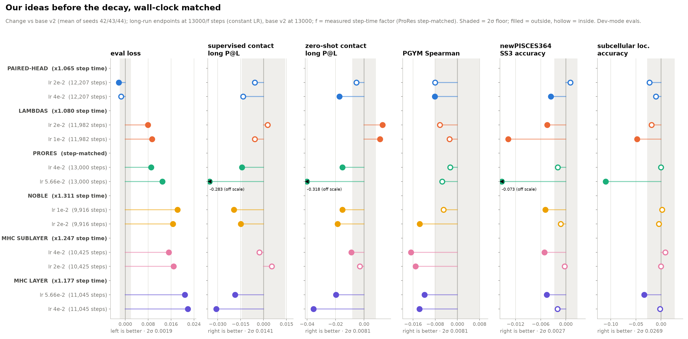

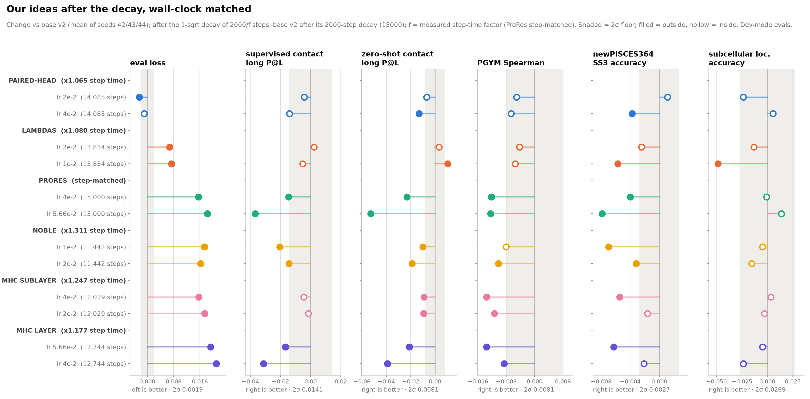

Figures from `sep07_abl/tools/plot_t2c_long.py` on fscratch, which reads the
training logs and the autoeval reports directly. Full downstream values in
[eval-table.md](eval-table.md#tier-2c-our-own-ideas-on-dense-base-v2).

### Verdict: nothing adopted

- **Paired-head is the only loss win**, -0.0024 after the decay at 2e-2, just
  past the 0.0019 floor, at one seed. Downstream it ties on everything at 2e-2
  (supervised -0.004, zero-shot -0.007, PGYM -0.005, newPISCES364 +0.001), and
  at 4e-2 it loses zero-shot and newPISCES364. **Not adopted** (decided
  2026-10-22). What the numbers support: a single-seed loss margin of 1.3x the
  floor, no downstream gain, and a 6.5% slower step.
- **Lambdas** cost +0.007 in loss. At 1e-2 zero-shot contact reads +0.010,
  which is about base v2's own seed range on that readout (0.0094), against
  -0.006 newPISCES364 and -0.049 scl. At 2e-2 it ties downstream. Not adopted.
- **ProRes loses even step-matched** (+0.016 after the decay), so its problem
  is not speed. At 5.66e-2 it collapsed contact before the decay (supervised
  -0.28, zero-shot -0.32, newPISCES364 -0.07) with a normal-looking loss
  (+0.013), and the decay mostly repaired it (-0.037 / -0.053); a second case
  of loss being blind to a structural collapse
  ([findings](findings.md#prores-at-566e-2-collapses-contact-while-loss-stays-normal)).
- **NOBLE, mHC sublayer and mHC layer** all lose 0.016-0.021 in loss and most
  downstream readouts at equal wall clock. In step-matched terms at 5000 NOBLE
  and mHC sublayer were ahead or level; their per-step cost is what loses. mHC
  sublayer holds supervised contact and scl but loses PGYM by 0.011-0.014. mHC
  layer is worst on contact, and its LR grid behaved oddly (1e-2 far behind,
  flat from 4e-2 up), which may be the DeepSeek-V4 init suiting sublayer
  wrapping rather than layer wrapping.

## Tree v2 parity and the MoE step-time factors (2026-10-26)

**Tree v2** is upstream `peymanvahidi/nanoplm` master `7fbb03a` (PRs #164-#167
merged 2026-10-26, which carry every frozen-tree patch: decay keeps the data
position, `empty_cache` after resume, `moe_nan_guard`, the mHC port), frozen at
`sep07_abl/pkgs/nanoplm-v2`. Runs select it with
`sbatch --export=ALL,NANOPLM_TREE=nanoplm-v2`; unset is tree v1, so every earlier
run is reproducible as before. `fsdp_keep_unsharded_across_accum` is gone as a
key: it is the default upstream (#159).

**Parity: passes.** Base v2 seed 42 (`t2a-ropeB-m92`, unchanged config) on tree
v2 for 3000 steps (job 2528654), against the same seed on tree v1 and seeds
43/44 as the noise reference (`tools/parity_v2.py`):

| step | v1 s42 | v1 s43 | v1 s44 | **v2 s42** | v2 - v1 s42 | v2 - v1 mean, z |
|---|---|---|---|---|---|---|
| 500 | 2.4773 | 2.4752 | 2.4760 | 2.4757 | -0.0016 | -0.54 |
| 1000 | 2.3887 | 2.3874 | 2.3874 | 2.3884 | -0.0003 | +0.66 |
| 1500 | 2.3460 | 2.3447 | 2.3446 | 2.3460 | +0.0000 | +1.05 |
| 2000 | 2.3179 | 2.3170 | 2.3166 | 2.3182 | +0.0003 | +1.21 |
| 2500 | 2.2974 | 2.2964 | 2.2960 | 2.2977 | +0.0003 | +1.28 |
| 3000 | 2.2803 | 2.2799 | 2.2800 | 2.2809 | +0.0006 | +0.97 |

z uses the pooled seed sd over these six evals (0.00074) times sqrt(4/3). Every
difference is inside 2 x sigma_seed (0.0019), and v2 sits closer to v1 seed 42 than
seeds 43/44 do: the train loss follows seed 42's wiggles step for step, because
the data order is identical and only kernel-level numerics changed (steps 40-200
agree to 0.0006). Tree v2 is also faster: 1889 vs 1931 ms/step here with the debug
tracker on, 1845 vs 1988 ms with it off (ovh3 against ovh2).

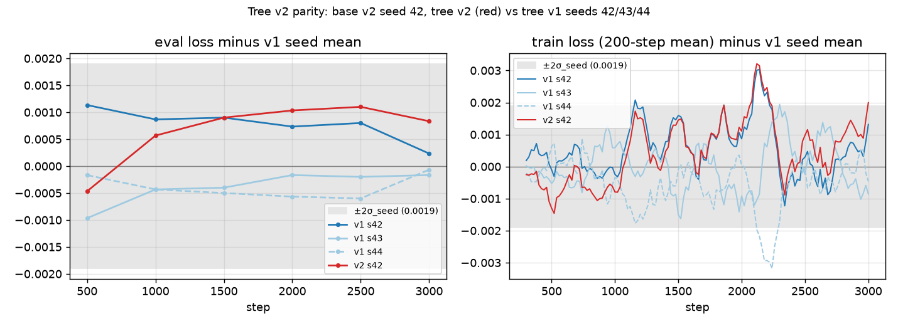

**MoE step-time factors** (job 2528655, one allocation, tree v2, debug tracker off,
dense first and last, 250 steps each, median dt over steps >= 100; dense 1841.2 /
1849.0 ms, drift 0.42%). The reference is tree-v2 dense, so MoE gets no credit for
the tree speedup:

| cell | ms/step | f | trunk round(13000/f) | decay round(2000/f) |
|---|---|---|---|---|
| g4-S8 | 2276 | 1.234 | 10539 | 1621 |
| g4-S12 | 2332 | 1.264 | 10287 | 1583 |
| g7-S8 | 2360 | 1.279 | 10164 | 1564 |
| g7-S12 | 2432 | 1.318 | 9862 | 1517 |

**Launched** 2026-10-26, ungated, `moe_nan_guard` on, configs `moe2-<cell>`
(from `configs/base2v2.yaml` via `make_configs.py`), each decay chained afterok
behind its trunk by `slurm/sbatch_decay_chain.sh` (which runs `make_decay.py`
inside the allocation once the trunk checkpoint exists; tested end to end on a
smoke, job 2529016): g4-S8 2530496/2530497, g4-S12 2530498/2530499, g7-S8
2530500/2530501, g7-S12 2530502/2530503. They are compared against dense base v2
at 15k (2.1249 / 2.1244 / 2.1246); a cell wins only by more than 2 x sigma_seed.

**Archive.** The 2026-10-06 to 10-14 weights (base2, d15k, t2a13k/15k, t2c,
t2c-long; 66 runs) are on project1 under `archive/sep07_abl/weights`, each
`cmp`-verified, plus `meta-2026-10-26.tar` (logs, configs, slurm, tools).

## Stage 4b result: MoE g4-S12 becomes base v3 (2026-10-27)

**Loss, wall-clock matched** (trunk at 13k-equivalent, decay to 15k-equivalent;
dense base v2 is the 3-seed mean, 2 x sigma_seed = 0.0019):

| cell | E, top_k, inter | f | trunk eval | decayed eval | decayed - dense |
|---|---|---|---|---|---|
| dense base v2 | | 1 | 2.1586 | 2.1246 | |
| g4-S8 | 31, 3, 672 | 1.234 | 2.1202 | 2.0833 | -0.0413 |
| **g4-S12** | 47, 3, 672 | 1.264 | 2.1134 | **2.0752** | **-0.0494** |
| g7-S8 | 55, 6, 384 | 1.279 | 2.1205 | 2.0840 | -0.0406 |
| g7-S12 | 83, 6, 384 | 1.318 | diverged at step 7212 | | |

Every surviving cell beats dense by about 20 sigma. g4-S12 beats the next cell by
0.0081, so there is no tie and the smallest-f tie rule never fires. **g4-S12 is
base v3** (`configs/base3.yaml`).

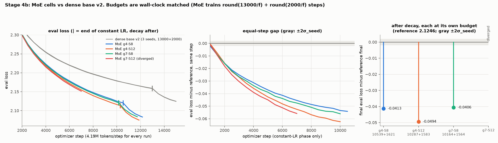

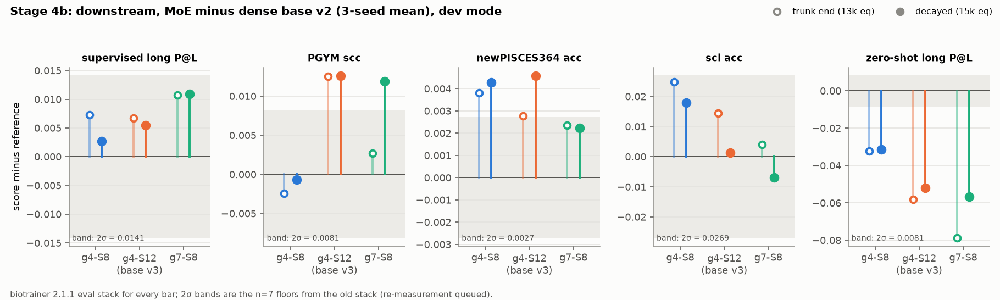

**g7-S12 diverged.** At step 7212 `layers.3.mlp.Wo` went non-finite one step after
a finite loss and a finite gradient, so the update itself overflowed, not the
forward. The run had no periodic checkpoints, its decay was cancelled by the
afterok chain, and stage 4c was told to exclude it (`FOURC_EXCLUDE`, amendment
2026-10-27). Root cause unknown; the suspect is the batched NorMuon update on the
3D expert weights (layer 3 is the first MoE layer). It is the largest expert count
(83) we have run. The same update path runs in base v3 and the canon arms, so the
risk is not zero there either.

**Downstream at 15k-equivalent** (MoE minus the dense 3-seed mean, both scored on
the new eval stack below; * = beyond that metric's 2 sigma):

| metric (2 sigma) | g4-S8 | g4-S12 | g7-S8 |
|---|---|---|---|
| supervised long P@L (0.0141) | +0.003 | +0.006 | +0.011 |
| PGYM scc (0.0081) | -0.001 | +0.013* | +0.012* |
| newPISCES364 (0.0027) | +0.004* | +0.005* | +0.002 |
| scl (0.0269) | +0.018 | +0.001 | -0.007 |
| zero-shot long P@L (0.0081) | -0.031* | -0.052* | -0.057* |

Supervised metrics follow the loss: flat to better, with PGYM and newPISCES
significant for base v3. **Zero-shot contact collapses under MoE**, and more so
for the cells with more experts (g4-S8 -0.031, g4-S12 -0.052, g7-S8 -0.057). The
zero-shot probe reads contacts off the categorical Jacobian (substitute residue i,
watch the logits at j); our hypothesis is that a substitution can flip the router's
expert choice at other positions, which adds noise to the Jacobian that has nothing
to do with contacts. It does not change the pick (the protocol ranks on loss).

**Tested 2026-10-28: most of the zero-shot drop is the probe, not the model.**
`diag/zs_contact/zs_contact_check.py` re-runs the battery's probe (same wrapper,
same conversion and metric, 69 selected_protein dev proteins) with every router
pinned to the expert set it picked for the wild type; combine weights are still
recomputed from the mutant's scores over that set. It reproduces the battery on
dense (s42 0.4809 vs 0.4811, s43 0.4691 vs 0.4690) and on MoE (default mode below).

| decayed ckpt | default | routing frozen | tokens whose expert set flips |
|---|---|---|---|
| dense s42 / s43 | 0.4809 / 0.4691 | n/a | n/a |
| g4-S12 (base v3) | 0.4235 | 0.4638 | 5.8% |
| g7-S8 | 0.4176 | 0.4550 | 10.2% |

Freezing recovers 0.040 of g4-S12's ~0.052 gap and 0.037 of g7-S8's ~0.057; the
cell with more route flips loses more. What remains (about -0.01 to -0.02 against
the dense pair) is inside the range a smoother-than-dense Jacobian would give and
is not chased further. Identity rows (mutant = wild type) are exactly zero in every
mode, so there is no batch/kernel noise term. Supervised contact, which reads the
embeddings directly, has no such artifact:

| supervised long P@L, decayed | selected_protein | casp14 | casp15 |
|---|---|---|---|
| dense 3-seed mean | 0.5003 | 0.2295 | 0.2180 |
| g4-S8 | 0.5030 | 0.2309 | 0.2143 |
| g4-S12 (base v3) | 0.5058 | 0.2301 | 0.2258 |
| g7-S8 | 0.5112 | 0.2235 | 0.2040 |

selected_protein is the deciding readout; casp14/15 are small (~20 proteins each)
and move both ways. Zero-shot contact stays in the battery but is not read as a
quality signal for MoE arms.

**New eval stack.** Tree v2 requires biotrainer 2.1.1 (`pydeps-bt211`), whose dev
mode is defined by a `pbc_dev_mode` column in a new PGYM reference file, so the
cached datasets had to be rebuilt (`eval/data-bt211`, reports in
`eval/out-bt211`, env in `eval/tools/env-bt211.txt`). The report schema changed
too (`§dev` suffixes, `PBC_ZEROSHOT_CONTACT-` prefixes, `task_results`);
`collect_results.py` reads both. Numbers on the two stacks are **not
comparable**: base v2 re-scored on the new one moves PGYM +0.03, supervised
contact +0.010 to +0.024, zero-shot contact +0.013 to +0.020, with newPISCES and
scl unchanged. Everything from 4b on is scored on the new stack, with dense base v2
re-scored as the reference.

## Stage 4c launched: canon on base v3 (2026-10-27)

Driver job 2539968 picked base v3 from the 4b decay logs, measured the canon
factors A-B-A against base v3 on one allocation (base3 2388.9 / 2396.7 ms, drift
0.33%), and submitted four arms, each with its decay chained. Canon is kernel 7,
CuTe backend, at sites A/B/C only: D sits inside the MLP, so on an MoE model it
would reach only the shared expert and the two leading dense layers.

| arm | f vs base v3 | trunk + decay steps | trunk job | decay job |
|---|---|---|---|---|
| a | 1.035 | 9941 + 1530 | 2540329 | 2540330 |
| c | 1.033 | 9959 + 1532 | 2540331 | 2540332 |
| ac | 1.105 | 9307 + 1432 | 2540333 | 2540334 |
| abc | 1.164 | 8834 + 1359 | 2540335 | 2540336 |

Steps are base v3's own budget (10287 + 1583) divided by f, so each arm gets the
same wall-clock as base v3. An arm is adopted only if its decayed loss beats base
v3 (2.0752) by more than 0.0019.

## Stage 4c at canon LR 1e-4: no arm beats base v3, and the canon LR was never tuned (2026-10-28)

**Result of the four arms as launched** (canon conv weights at AdamW 1e-4, see
below; matched wall-clock; base v3 2.1134 at trunk end, 2.0752 decayed):

| arm | f | trunk eval | decayed eval | decayed - base v3 | equal-step gap at 5000 |
|---|---|---|---|---|---|
| a | 1.035 | 2.1185 | 2.0799 | +0.0047 | +0.0042 |
| c | 1.033 | 2.1162 | 2.0781 | +0.0029 | +0.0014 |
| ac | 1.105 | 2.1259 | 2.0875 | +0.0123 | +0.0032 |
| abc | 1.164 | 2.1330 | 2.0952 | +0.0200 | +0.0046 |

Every arm loses, and it loses **at equal steps too**, so this is not only canon's
step-time cost. The gap at equal steps grew from step 2000 on.

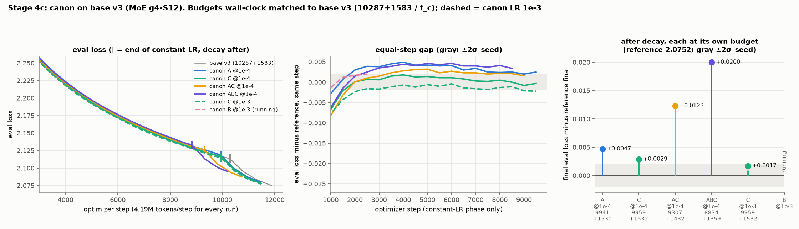

**Why: the canon weights sat in the AdamW group at 1e-4.** The canon conv is
depthwise, weight `(C, 1, 7)`, so it is 3D and not a routed expert, and
`optim.py`'s fallthrough sends it to the AdamW group at `adam_learning_rate`
(1e-4, the embedding/norm LR that was never tuned for anything else; the
Tier 1 sweep put that group's plateau at 1e-3 to 1e-2). Its init is PyTorch's
default (kaiming-uniform), untouched by the model's init, so every canon site
started as a random depthwise filter on the residual stream and learned slowly.
AdamW is the right optimizer for it: a depthwise filter is not a linear map
between channel spaces, so Muon's orthogonalization has nothing to work with
(flattened it couples 1024 independent filters; batched per channel it reduces
to normalizing a 1x7 row). The 4c design also skipped the per-variant LR sweep
that method.md asks for inside an architecture tier. That was a miss.

**Tree v2c** (`pkgs/nanoplm-v2c`, frozen 2026-10-27) is tree v2 plus one knob,
`pretraining.canon_learning_rate`: when set, the canon conv weights and biases
get their own AdamW group at that LR (same wd/betas/eps); unset, the param
groups are exactly tree v2's. Patch in `pkgs/nanoplm-v2c.patch`.

**Canon LR sweep on arm c** (fixed step 5000, constant LR, same seed and data
order as `canon3-c`, which supplies the 1e-4 point; jobs 2552996-2552998):

| step | 1e-4 | **1e-3** | 3e-3 | 1e-2 | base v3 |
|---|---|---|---|---|---|
| 3000 | 2.2538 | **2.2515** | 2.2523 | 2.2579 | 2.2532 |
| 4000 | 2.2204 | **2.2179** | 2.2188 | 2.2253 | 2.2186 |
| 5000 | 2.1938 | **2.1918** | 2.1939 | 2.2005 | 2.1924 |

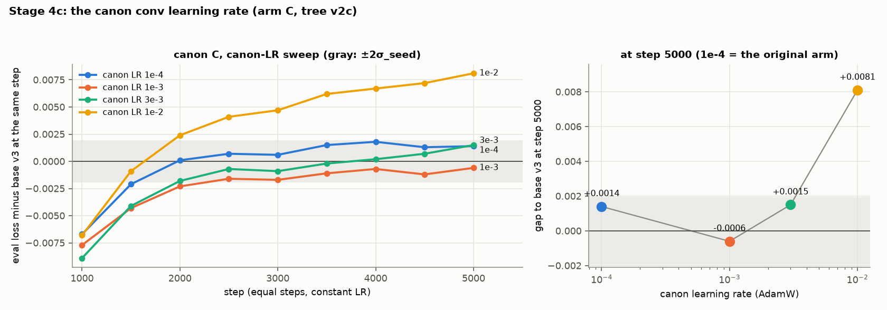

1e-3 wins at every eval and is interior to the grid. Tuned, canon C is still only
-0.0006 against base v3 at equal steps, well inside 2 x sigma_seed, before its
3.3% step-time cost.

**Follow-ups in flight** (all tree v2c, canon LR 1e-3, wall-clock matched to base
v3, decays chained):

| run | what | steps | trunk / decay job |
|---|---|---|---|
| `canon3c-clr1e-3-long` | the sweep winner continued from step 5000 | 9959 + 1532 | 2559576 / 2559578 |
| `canon3-b` | B alone (4c only had B inside abc); f_b = 1.088 measured A-B-A (job 2557945, base3 drift 0.35%) | 9452 + 1454 | 2558419 / 2558420 |
| `canon3-ac-clr1e-3` | AC at the tuned LR | 9307 + 1432 | 2561767 / 2561768 |

The LR was swept on C only; that it transfers to A and B is assumed, not shown.
Win rule unchanged: decayed loss below 2.0733.

Figures are regenerated by `sep07_abl/tools/plot_stage4.py <figures-dir>` from the logs and
eval reports; runs still in flight are drawn as far as they have got. The canon downstream
figure (`stage4c-downstream.png`) follows once eval job 2561953 lands.
